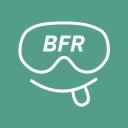

<p align="center"></p>

# Babble Frame Runtime

Eye and mouth expression tracking that runs on the Steam Frame itself.

Babble Frame Runtime reads the Steam Frame's eye cameras, and a USB Babble face tracker for the mouth, and turns their
images into face tracking values (eye openness, widening, pupil dilation and per-eye gaze; jaw, lips, cheeks and
tongue), which it sends to VRCFaceTracking on your PC. Everything runs on the headset.

It is installed as a SteamVR driver. The driver starts the runtime as a separate process and restarts it if it stops,
so a problem in the runtime never affects SteamVR.

## Features

- **Eye expressions:** openness, widen and pupil dilation per eye, from the Frame's eye cameras. Openness is
  calibrated per person automatically, in the style of SRanipal.
- **Mouth tracking:** 43 blendshapes from a USB Babble face tracker plugged into the headset (the mono model, 30 Hz),
  with a neural network running on the CPU (ExecuTorch with XNNPACK). Mouth tracking from the Frame's own front-port
  stereo cameras is in development and only in dev builds (see Build profiles).
- **Gaze:** each eye's own gaze from the headset's eye service, or SteamVR's combined gaze.
- **Presence:** tracking pauses while the headset is off the head (proximity sensor), and the cameras turn off.
- **SteamVR Settings:** an Expression Tracking section to turn mouth and eye tracking on and off and set the eye
  tracking rate.
- **Outputs:**
  - OSC in the Baballonia format for VRCFaceTracking.
  - A plugin interface for other outputs, with a template.
- **A debug overlay:** a SteamVR dashboard tab with live gaze and eye readouts, and a visualizer launcher.
- **Dataset capture:** an optional guided recording app, installed from the overlay's Diagnostics page. The runtime
  records every camera frame for it (lossless x264 through ffmpeg), then packages (hardware H.265), encrypts and
  uploads the sessions the user consented to (see [docs/dataset-capture.md](docs/dataset-capture.md)).

## Status

Work in progress. The mouth and eye models are prototypes; the runtime keeps models swappable so better ones can be
dropped in.

## Quick start

1. Get the source on a PC and copy it to the headset.
2. Build ExecuTorch once, then build the driver, on the headset.
3. Register the driver with `vrpathreg.sh`, then restart SteamVR.

The full steps are in **[docs/building.md](docs/building.md)**.

Once it runs, the runtime sends OSC to `127.0.0.1:8888`, which the Baballonia module for VRCFaceTracking reads. Other
outputs can be added as plugins; see [docs/output-modules.md](docs/output-modules.md).

## Build profiles

`-DBABBLE_PROFILE=release` (what releases ship) builds the USB Babble tracker as the only mouth and VRCFaceTracking as
the only output; it leaves out the Frame's front-port mouth cameras and their camera arbiter, the VRChat-native output,
the visualizer launcher, the camera-stream switch and the unused models. The default, `dev`, builds everything. The
profile's `defaults.json` and SteamVR settings files are derived at configure time from the full ones
(`cmake/babble_profile.cmake`), so there is one source of truth.

## Documentation

| Document                                         | Contents                                                       |
|--------------------------------------------------|----------------------------------------------------------------|
| [building.md](docs/building.md)                  | Building, installing, updating, tests, plugins.                |
| [settings.md](docs/settings.md)                  | The Expression Tracking settings and the debug overlay.        |
| [configuration.md](docs/configuration.md)        | Config files and every config key.                             |
| [architecture.md](docs/architecture.md)          | How the runtime is put together.                               |
| [eye-tracking.md](docs/eye-tracking.md)          | Eye models, calibration, gaze and openness sources.            |
| [output-modules.md](docs/output-modules.md)      | The OSC output, the signal list, output plugins and their ABI. |
| [models.md](docs/models.md)                      | The shipped models, exporting and swapping them.               |
| [debugging.md](docs/debugging.md)                | Logs, stats, tools and common problems.                        |
| [dataset-capture.md](docs/dataset-capture.md)    | Recording for the dataset app, its protocol, installs, uploads. |

## Repository layout

```
driver/          SteamVR driver shim, settings schema, driver manifest
runtime/
    src/         the runtime: camera, model, state, sink, platform, ui, core
    resources/   default config, models (the profile picks which ship), mouth calibration, fonts, icons
    tests/       unit tests
sdk/             output plugin ABI header and plugin template
tools/           ExecuTorch build script, model export, golden data, probes, icon rendering
third_party/     OpenVR headers, and submodules: ExecuTorch, nlohmann/json, doctest, stb
```
